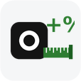
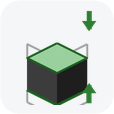

# ХУЙ вам, проектировщики.

> **EN:** pyRevit extension with MEP tools for Revit (tags, schematics, plenum families, ESKD sketches, schedules, sheet export). The interface is in Russian; an English UI is planned.


## ХУЙ — плагин pyRevit

Чтобы рутина в Revit не омрачала ваше настроение, используйте ХУЙ. ХУЙ да не ХУЙ(я), но всё же хуже без ХУЙ(я).

> [!NOTE]
> Своя вкладка «ХУЙ» в Revit (pyRevit), сразу после «Вставить». Панели: **Блядь** (поиск и выделение) · **Захуярить** (модель) · **Разъебать** (взрыв-схемы) · **Пиздато** (оформление) · **Сдать нахуй** (выпуск) · **Ёбань** (Excel).

## Установка

> [!IMPORTANT]
> Проверено только на **Revit 2025.4** и **pyRevit 6.1.0**. На других версиях Revit и pyRevit плагин не проверялся.

**1. pyRevit 6.1.0.** Закройте Revit, скачайте и запустите установщик:
- [pyRevit_6.1.0.26047_signed.exe](https://github.com/pyrevitlabs/pyRevit/releases/download/v6.1.0.26047%2B2255/pyRevit_6.1.0.26047_signed.exe) — обычная установка (для своего пользователя);
- все файлы версии — на [странице релиза 6.1.0](https://github.com/pyrevitlabs/pyRevit/releases/tag/v6.1.0.26047%2B2255).

После установки запустите Revit — на ленте появится вкладка **pyRevit**.

**2. ХУЙ.** Один из двух способов:
- **Через менеджер расширений pyRevit.** pyRevit → **Расширения** (Extensions) → внизу в поле «URL Git» вставьте `https://github.com/Budzhak/HUI.git` → **Добавить и установить**.
- **Вручную.** Вверху этой страницы: **Code → Download ZIP**. Распакуйте архив в `%APPDATA%\pyRevit\Extensions\` и переименуйте папку `HUI-main` в `HUI.extension`.

**3. Запуск.** pyRevit → **Reload**. Вкладка «ХУЙ» появится в конце ленты. Чтобы она стояла сразу после «Вставить», в файле `%APPDATA%\pyRevit\hui_settings.json` поставьте `"tab_after_insert": true` и сделайте Reload.

**4. Для «PDF вектор» (необязательно).** Облегчение PDF работает во внешнем Python 3 (ставится отдельно, [python.org](https://www.python.org/downloads/windows/)) с библиотеками:
```
py -m pip install --user pikepdf shapely numpy
```
Без них PDF выгружается средствами Revit, без облегчения.

**Обновление:** pyRevit → **Расширения** → ХУЙ → обновить (или скачать ZIP заново), затем Reload.

> [!WARNING]
> Плагин писался под конкретные проекты и шаблоны (ADSK, свои параметры `db_*`). Перед массовыми изменениями — пробный запуск и сохранение модели.

## Кнопки

| | Панель | Кнопка | Коротко |
|---|---|---|---|
|  | Блядь | [Распознать](docs/Кнопки/Распознать.md) | список выделенного по типам с картинками |
|  | Блядь | [Идентификация фильтра](docs/Кнопки/Идентификация%20фильтра.md) | какие фильтры вида действуют на элемент (и в связи), их правила; выключить фильтр из окна |
|  | Блядь | [Зафильтровать тип элемента](docs/Кнопки/Зафильтровать%20тип%20элемента.md) | фильтр видимости по типу выделенного элемента — сразу на вид |
|  | Блядь | [Пометить](docs/Кнопки/Пометить.md) | метка в параметр + спецификация по ней |
|  | Блядь | [Безымянная хуйня](docs/Кнопки/Безымянная%20хуйня.md) | участки труб без марки на виде: список, «Показать» выделяет весь участок и приближает, «◀ / ▶» — соседний |
|  | Захуярить | [Равнение](docs/Кнопки/Равнение.md) | трубы, воздуховоды, лотки: на ось опорного, по высоте, стояк вертикально |
|  | Захуярить | [Пленум](docs/Кнопки/Пленум.md) | семейство пленума с врезками |
|  | Захуярить | [Как у тебя](docs/Кнопки/Как%20у%20тебя.md) | заменить элемент на образец |
|  | Захуярить | [Прозрачные связи](docs/Кнопки/Прозрачные%20связи.md) | слайдер прозрачности связей (через фильтры) |
|  | Захуярить | [Беспорядочные связи](docs/Кнопки/Беспорядочные%20связи.md) | параметры IFC/RVT-связи в проект — для фильтров |
|  | Захуярить | [Масштаб 3D](docs/Кнопки/Масштаб%203D.md) | «( 1 : N)» в заголовках 3D-видов |
|  | Захуярить | [Количество](docs/Кнопки/Количество.md) | **новая 21.10.2026** · количество с запасом по правилам (категория + условие → как считать → запас), здание по областям видимости, проба «было → станет» |
|  | Захуярить | [Наименования](docs/Кнопки/Наименования.md) | **новая 21.10.2026** · ADSK_Наименование, db_Раздел, ключ сортировки по шаблонам с пробой «было → станет» |
|  | Захуярить | [Объёмы](docs/Кнопки/Объёмы.md) | **новая 21.10.2026** · объёмы пространств и раскраска вида фильтрами по параметру, легенды с суммами и итогом |
|  | Захуярить | [Эскиз](docs/Кнопки/Эскиз.md) | **новая 28.10.2026** · эскиз изделия по ЕСКД в легенде из параметров семейства: виды, аксонометрия, размеры, отверстия, ТТ |
|  | Захуярить | [Подрезать 3D](docs/Кнопки/Подрезать%203D.md) | рамка 3D-вида сверху и снизу по уровням со смещением, как «Секущий диапазон» |
|  | Разъебать | [К хуям](docs/Кнопки/К%20хуям.md) | взрыв-схема выделенного по соединениям |
|  | Пиздато | [По красоте](docs/Кнопки/По%20красоте.md) | марки: выравнивание, колонка марок, сброс марок, отметки на взрыв-схеме; ⚠ «Умные выноски» и «Разнести наложенные» — в карантине |
| | Пиздато | 11 малых кнопок (бывш. панель «Оформить») | Колонка, Конец в середину, Равный шаг, Сброс марок, Реверс, Друг под другом, Рядом, Измерить шаг, Групповуха, Нумерация кликами, Нумерация по часовой — команды «По красоте» без меню; есть и на вкладке «Изменить \| …» |
|  | Пиздато | [Прямая выноска](docs/Кнопки/Прямая%20выноска.md) | щелчок по марке, щелчок, где ей стоять — прямая выноска, конец сам едет вдоль трубы |
|  | Пиздато | [Участки фреона](docs/Кнопки/Участки%20фреона.md) | участки жидкостной линии фреонопровода: номер, размер, отводы, перепад, длина; спецификация «db_Участки_<система>» |
|  | Сдать нахуй | [Опись хуйни](docs/Кнопки/Опись%20хуйни.md) | содержимое листов → Excel |
|  | Сдать нахуй | [По порядку, суки](docs/Кнопки/По%20порядку%2C%20суки.md) | номера листов по порядку в группах диспетчера, с предпросмотром |
|  | Сдать нахуй | [PDF вектор](docs/Кнопки/PDF%20вектор.md) | листы в лёгкий векторный PDF (без растровых листов, с облегчением) |
|  | Ёбань | [Посмотреть](docs/Кнопки/Посмотреть.md) | спецификация → Excel (версия 3, 20.10.2026): копия ведомости, «Как на виде» — править здесь, «ElementId» — эталон |
|  | Ёбань | [Забрать](docs/Кнопки/Забрать.md) | Excel → Revit (**не трогать код**) |
|  | Ёбань | [Под копирку](docs/Кнопки/Под%20копирку.md) | оформление ведомости → на ведомости с теми же графами; Shift+щелчок — ширины граф |

Библиотеки (общий код кнопок): [Библиотеки](docs/Кнопки/Библиотеки.md).

## Общие правила
- **Панель «ХУЙ» на вкладке «Изменить | …»**: когда что-то выделено, на контекстной вкладке Revit есть наша панель — «Распознать», «Чей фильтр», «Фильтр по типу», «По красоте», «Выровнять MEP». Работают так же, как с вкладки ХУЙ. Ставится автоматически при запуске Revit и после Reload pyRevit.
- **⚠ Карантин** — нестабильные кнопки и кнопки без пробы в репозиторий не входят; добавляются, когда выходят из карантина. Внутри «По красоте» команды «Умные выноски» и «Разнести наложенные» помечены ⚠ и перед запуском спрашивают подтверждение (`lib/quarantine.py`).
- **Общее правило кнопок (21.10.2026):** где (выделенное / вид / модель) → что (операции галочками, числа — полями ввода) → проба «было → станет» → «Применить / В Excel / Отмена» → отчёт и одна отмена Ctrl+Z. Удаление — только отдельным шагом со списком.
- Перед массовыми изменениями — пробный запуск на одном виде или элементе, и сохранить модель.
- Все кнопки работают одной транзакцией: отмена — **Ctrl+Z** (исключения указаны в инструкциях).
- Оформление видов в плагине — только **фильтрами**, не «Графикой элемента».
- Окна — в едином стиле (`hui_forms`, чёрный/зелёный/белый).

## Лицензия

[GPL-3.0](LICENSE). Часть окон сделана на основе форм [pyRevit](https://github.com/pyrevitlabs/pyRevit) (GPL-3.0).
