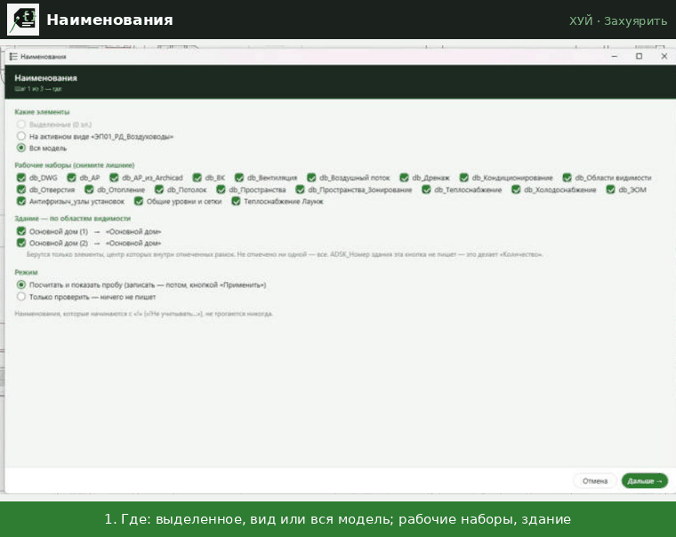

# Наименования

↩ [ХУЙ](../../README.md)

> [!NOTE]
> **Что делает**
> Пишет ADSK_Наименование по шаблонам, которые видны в окне и правятся там же. Там же заполняет db_Раздел и ключ сортировки. Сначала показывает пробу «было → станет»; в модель пишет только по кнопке «Применить». Замена кнопки «Обозвать» (она в карантине).

## Демонстрация

Где искать, шаблоны «категория + условие → как назвать», проба «было → станет»: модель не меняется до «Применить».

## Когда применять
- После правки трассы, если другие надстройки переписали имена.
- Перед выдачей спецификации — вместе с [Количеством](Количество.md).

## Как пользоваться
1. **Где:** выделенное / активный вид / вся модель; рабочие наборы; здание по областям видимости (как в «Количестве»).
2. **Правила:** категория + условие → шаблон. Правила идут сверху вниз, срабатывает первое подошедшее. Вкладки «Таблицы» (толщина стали, стенка меди) и «Разделы и порядок».
3. **Проба:** «было → станет» по вкладкам. «Применить» — запись, иначе модель не меняется.

## Шаблон
- `{Параметр}` — значение параметра элемента; `{основа: Параметр}` — у основы (изоляция → труба/воздуховод); `{макс: A; B}`.
- Модификаторы через `|`: `округл N`, `без знака`, `целое`, `половина`, `первый`, `х`, `запятая`, `таблица <имя>`.
- `[ … ]` — необязательная часть: выпадает, если внутри пусто.
- Наименование с «!» не трогается (ручное).

## Решения db (21.10.2026)
- Сечения, собранные из двух параметров, — с **русской «х»**; если размер берётся из параметра «Размер», где уже стоит латинская x, — оставить как есть. Поэтому стандартные правила труб — с русской «х» (1 499 переименований в модели).
- «Соединения» (ADSK_Объединение) сейчас не нужны.
- Ключи сортировки, заданные руками (не оканчиваются на «|имя|марка»), кнопка не трогает.

## Что меняется в модели
ADSK_Наименование, db_Раздел, ключ сортировки — только у строк пробы, по «Применить».

## Ограничения
- Правила — файл, который выбираете вы (как в «Количестве»); стандартные правила воспроизводят 16 912 наименований рабочей модели.
- Другие надстройки с автообновлением имён после правки трассы перепишут имена по-своему.

## Отмена
**Ctrl+Z** — одна транзакция.

## Техническое (для Claude)
- `lib/hui_naim.py`: `parse` / `placeholder` / `render` / `check` (шаблоны), `DEFAULT_RULES`, `compute` → changes/fail, `compute_sections` → (changes, manual), `apply`.
- Окно — `Naim.pushbutton/script.py` (f8d8ad6b…), сбор элементов и рамки — из `lib/hui_qty.py`.
