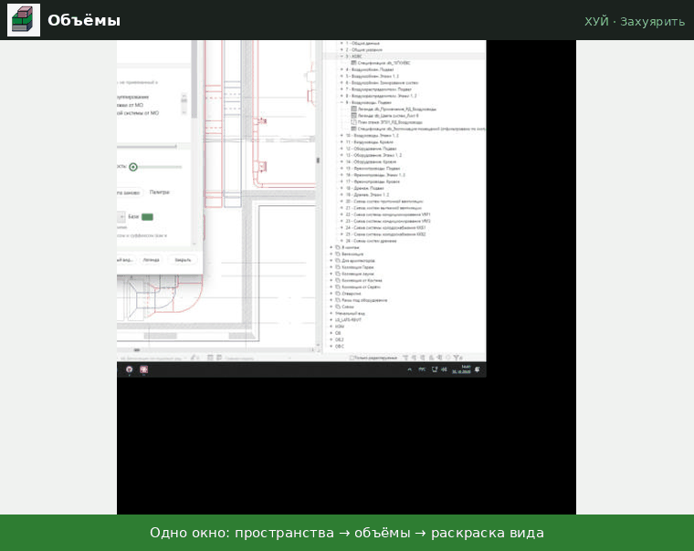

# Объёмы

↩ [ХУЙ](../../README.md)

> [!NOTE]
> **Что делает**
> Строит объёмные тела пространств (обобщённые модели) со значениями их параметров и красит вид по любому параметру — **только фильтрами вида**. Делает легенды «как Заливка цветом» с суммами (расход воздуха и т. п.) и итогом.

## Демонстрация

Одно окно: какие пространства и параметры перенести в объёмы, раскраска вида фильтрами и легенда.

## Как пользоваться
1. **Пространства:** выделенные / на активном виде / все; **области видимости** (рамки зданий) — галочками; не отмечено ни одной — все.
2. **Объёмы:** галочки параметров, которые копируются в тело → «Создать / обновить», «Удалить объёмы ХУЙ», «Удалить вне рамок», «Удалить сторонние объёмы». Перед каждым действием — список и «Да/Нет».
3. **Раскраска:** параметр → значения с цветами (щелчок по квадрату — свой цвет).
   - Прозрачность; «Бесцветные» — объёмы без значения: 0–99 %, 100 — скрыты (поле ввода, ↑/↓, колесо — по 1 %).
   - Палитры (Природа, Сочная, Ретро, Пастель, Скандинавия, Море, Закат) или «Цветовой круг…» — схема (моно, аналогия, комплемент, триада, тетрада, квадрат…), тон, базовый цвет.
   - «Не повторять цвета: …» — с какими параметрами не совпадать; «Подобрать цвета заново».
4. **Подпись в легенде:** поля с префиксом и суффиксом, как в редакторе меток: значение, расшифровка, количество пространств, «Сумма: <параметр>». У каждого значения — текст справа: «дополнить» или «заменить» подпись. Зелёным — как будет в легенде.
5. **Итог под легендой** (22.10): «Линия» (до конца последней строки), «Счётчик» (поля: количество строк, количество пространств, «Итог суммы: <параметр>» — с префиксом и суффиксом), «Примечание» (свой текст). Счётчик и примечание переносятся по длине линии.
6. Кнопки внизу: **Покрасить вид** (и перерисовать легенду этого параметра, если есть), **Новый вид…** (копия вида под параметр), **Легенда**. Ctrl+колесо — масштаб окна, Ctrl+0 — 100 %.

## Что меняется в модели
- DirectShape «Обобщённые модели» (ApplicationId «ХУЙ.Объёмы», «Комментарии» = `#объём`), рабочий набор db_Пространства_Зонирование; выбранные параметры привязываются к обобщённым моделям.
- Фильтры вида `db_Объём_<параметр>_<значение>` (+ «(пусто)»): параметр = значение И «Комментарии» содержит `#объём`.
- Легенды `db_Легенда_Объёмы_<параметр>`: типы заливки `db_Объём_<HEX>`, тексты, линия итога. При перерисовке сохраняются заголовок, типы текста (строки, счётчик, примечание), стиль линии и положение.

## Ограничения
- Суммы и количество — **по пространствам** (источник правды), в пределах отмеченных рамок; сверено с ХОВС 22.10 — все 26 систем совпали.
- Сложные пространства строятся сеткой (в рабочей модели таких было 6) — проверить их раскраску глазами.
- Вид под шаблоном с фильтрами — красить нельзя (снимите шаблон или красьте копию).

## Отмена
**Ctrl+Z** — каждое действие одной транзакцией.

## Техническое (для Claude)
- `lib/hui_vol.py`: `spaces`, `plan`, `build` (цепочка геометрии: solid → clone → выдавливание контура → сетка), `paint`, `space_stats`, `sums`, `total`, `compose`, `make_legend(doc, param, rows, title, foot)`; палитры `PALETTES`, `wheel_colors`, `free_colors`.
- Окно — `Vol.pushbutton/script.py` (WPF, `@guarded`), настройки — `hui_settings` ключ `vol` (colors, desc, desc_mode, label_parts_by, foot_by, uniq_with, palette_by, wheel_by, frames, transp, transp_empty, zoom, split, params, paint_param).
- Линии эскиза заливки — тоже DetailCurve в легенде: их отсекать через `GetDependentElements`. `TextNote.Width` — в единицах листа.
