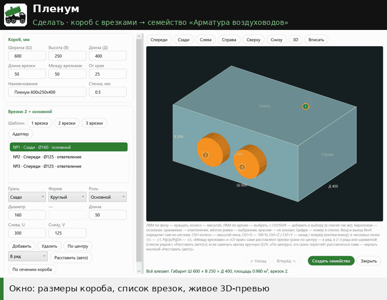

# Пленум

↩ [XYZ](../../README.md)

> [!NOTE]
> **Что делает**
> Создаёт по вашим размерам семейство пленума (камеры статического давления) — короб с врезками — в категории «Арматура воздуховодов» с соединителями. Семейство загружается в проект, после чего его можно сразу расставлять.

## Демонстрация

Размеры короба → шаблон врезок → «Добавить» (врезки сами встают по центру грани) → «Шахматка» и «Расставить (авто)» → превью крутится мышью. Дальше «Создать семейство» — оно загружается в проект и сразу ставится.

## Когда применять
Нужен пленум или переходная камера под решётку или диффузор нестандартной конфигурации, а готового семейства нет.

## Как пользоваться
1. Откройте проект (не семейство) и нажмите «Пленум».
2. Окно «Пленум», левая часть:
   - «Короб, мм»: «Ширина (Ш)» (600), «Высота (В)» (250), «Длина (Д)» (400), «Длина врезки» (50), «Между врезками» (50), «От края» (25), «Наименование», «Стенка, мм» (0,5).
   - «Врезки»: готовые шаблоны «1 врезка», «2 врезки», «3 врезки», «Адаптер»; список врезок; для выбранной — «Грань» (Спереди/Сзади/Слева/Справа/Сверху/Снизу), «Форма» (Круглый/Прямоугольный), «Роль» (Ответвление/Основной), размеры, «Длина», «Слева, U», «Снизу, V».
   - Кнопки: «Добавить», «Удалить», «По центру», список расстановки + «Расставить (авто)», «По сечению короба» (прямоугольная врезка во всю грань, без перехода).
3. Правая часть — 3D-превью. ЛКМ по фону вращает, колесо масштабирует, ЛКМ по врезке выбирает её (с Ctrl/Shift — добавляет к выбору). Кнопки ракурсов и «Вписать».
   - Цвета: бирюзовая врезка — основная, оранжевая — ответвление, жёлтая рамка — выбранная, красная — не влезает.
4. Под превью строка проверки. Если всё в порядке, она зелёная и показывает габарит и площадь. Красная перечисляет проблемы, и тогда «Создать семейство» недоступна.
5. Окно тянется за край; разделитель между настройками и превью двигается; Ctrl+колесо — масштаб настроек, Ctrl+0 — 100 %; размер, разделитель и масштаб запоминаются. В числовых полях ↑/↓ — ±1, PgUp/PgDn — ±5.
   - **«↶ Назад» / «Вперёд ↷»** (внизу, рядом с «Создать семейство») и **Ctrl+Z / Ctrl+Y** (Ctrl+Shift+Z) — история правок окна: размеры, врезки, расстановка. Шаблоны («1 врезка» … «Адаптер») заменяют все врезки — вернуть прежние можно «Назад». Набор в поле запоминается одним шагом, когда пауза больше 0,6 с; каждое нажатие кнопки — отдельный шаг. До 200 шагов, пока окно открыто.
6. «Создать семейство». Семейство создаётся и загружается, после чего Revit предлагает разместить экземпляр. Щёлкайте, Esc завершает.

## Режимы и настройки
- **Технологические минимумы** (db 28.10.2026): между стенками соседних патрубков — не меньше **50 мм**, от патрубка до края грани — не меньше **25 мм**: жестянщику нужно место под крепёж (заклёпки, саморезы, отбортовка), фальц и угол короба. Меньше ввести можно, но расстановка и проверка всё равно идут по минимуму, а строка проверки красная — семейство не создаётся. Врезка во всю ширину или высоту грани (продолжение короба) от этого правила по своей стороне освобождена.
- Расстановка врезок: «Между врезками» и «От края» автоматически расставляют врезки грани. Способ — в списке рядом с «Расставить (авто)», для грани выбранных врезок:
  - **В ряд** — один ряд по центру грани (как раньше);
  - **2 ряда / 3 ряда** — сеткой: верхние ряды полные, каждый ряд по центру, между рядами — «Между врезками»;
  - **Шахматка** — 2 ряда: сверху на одну больше, нижние — посередине между верхними; занимает грань с отступом «От края» по ширине и высоте. Пример: торец 1260×440, 7 × Ø200, зазор 50, от края 25 → сверху 4 (U 125 / 461.7 / 798.3 / 1135, V 315), снизу 3 (U 293.3 / 630 / 966.7, V 125). На высоте 410 те же 7 × Ø200 шахматкой не помещаются с технологическими минимумами.
  - Порядок — по номерам в списке: первые — верхний ряд. Не влезает — врезки красные, строка проверки скажет, какие.
  - Если сдвинуть врезку вручную (U/V, «По центру»), эта грань больше не расставляется сама. Вернуть — «Расставить (авто)».
- При выборе нескольких врезок правка размеров и длины применяется ко всем выбранным.
- Прямоугольная врезка во всю грань считается продолжением короба и входит в габарит. Только у неё допускается длина 0.

## Что меняется в модели
- Создаётся семейство `db_Пленум_<Ш>x<В>x<Д>_<N>вр`, где N — число ответвлений (основная врезка не считается). Типоразмер называется `<Ш>x<В>x<Д>`. Если габариты те же, а конфигурация другая, к имени добавляется `_2`, `_3` и т. д.
- Если такая же конфигурация уже есть (сравнивается по «db_Код конфигурации»), новое семейство не создаётся — используется существующее.
- Параметры семейства:
  - ADSK из ФОП: ADSK_Размер_Ширина/Высота/Длина/Площадь (площадь по формуле), ADSK_Наименование, ADSK_Марка, ADSK_Код изделия, ADSK_Завод-изготовитель, ADSK_Единица измерения («шт»), ADSK_Количество (1), ADSK_Масса, ADSK_Материал наименование, ADSK_Толщина стенки, ADSK_Примечание (экземпляр);
  - свои: db_Наименование краткое («Пленум»), db_Размер, db_Код конфигурации;
  - по каждой врезке: db_В<n>_Грань, _Роль, _Размер, _U, _V, _Длина.
- Тип детали — «Разрывает», чтобы соединители были видны в проекте. Основная врезка — первичный соединитель. Все соединители **двусторонние**: вход и выход Revit определяет сам по системе, одно семейство годится и на приток, и на вытяжку (db 28.10.2026, проверено на рабочей модели с откатом: при перепутанных «Внутрь/Наружу» расход в магистрали искажался — 1110 вместо 960 м³/ч; двусторонние и «Фитинг» дают верные 960). Переключатель «Приточный / Вытяжной» и параметр db_Режим убраны.
- Файл .rfa сохраняется в `%TEMP%\db_Пленум`.

## Ограничения и подводные камни
- Общие параметры берутся из файла `ФОП/db_ФОП.txt`, который лежит в самом расширении (только нужные плагину параметры ADSK и `db_`, те же GUID, что в ФОП ADSK). Если файла нет — из файла общих параметров, заданного в Revit (Управление → Общие параметры).
- Нужен шаблон «Метрическая система, типовая модель.rft» в папке шаблонов семейств Revit.
- Основная врезка должна быть ровно одна.
- Соединители создаются с системой «Глобальный» (DuctSystemType.Global).

## Отмена
- Размещённые экземпляры удаляются обычным способом.
- Семейство удаляется из диспетчера проекта. Отменяется ли загрузка через Ctrl+Z, в коде не видно: загрузка идёт вне явной транзакции кнопки.

## Техническое (для Claude)
- `script.py`: `PlenumWindow` (WPF + Canvas-превью), `problems()`/`validate()`, `config_hash` (md5[:6], версия схемы `v6`: без режима, только из параметров типа — Грань, Роль, Размер, U, V, Длина, поэтому код пересчитывается у готового семейства), `pick_family`, `build_family` (NewFamilyDocument → OST_DuctAccessory, `FAMILY_CONTENT_PART_TYPE = BreaksInto`, выдавливания, `ConnectorElement.CreateDuctConnector`), `fd.LoadFamily(doc)`, `PromptForFamilyInstancePlacement`.
- Константы: `FOP`, `OUT_DIR`, `CODE_PARAM = 'db_Код конфигурации'`.

> [!TIP]
> Демонстрация и обсуждение — в Telegram-канале [@xyz_for_revit](https://t.me/xyz_for_revit).
