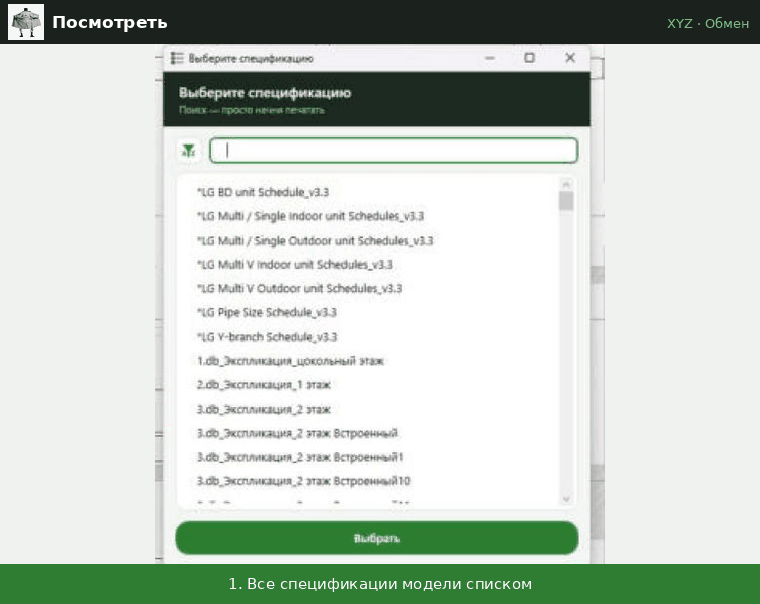

# Посмотреть

↩ [XYZ](../../README.md)

> [!NOTE]
> **Что делает**
> Выгружает выбранную спецификацию в Excel. Правят на вкладке «Как на виде» — она выглядит как сама спецификация. Правки возвращаются в модель кнопкой [Забрать](Забрать.md).

> [!IMPORTANT]
> **Версия 3 (20.10.2026).** Вкладка «Как в Revit» теперь называется «Как на виде», «Лист1» скрыт, появились вкладки «<имя ведомости>» и «ElementId». Большие ведомости выгружаются в десятки раз быстрее: 19,5 тыс. элементов — 51 с вместо часа.

## Демонстрация

Все спецификации модели списком, поиск по названию; «Выбрать» — спецификация в Excel.

## Когда применять
- Массово поправить параметры (наименования, марки, позиции, коды) в привычном виде спецификации и вернуть их в модель кнопкой «Забрать».
- Отдать спецификацию в Excel (вкладка с именем ведомости — точная копия таблицы).

## Как пользоваться
1. Можно заранее открыть нужную спецификацию.
2. Нажмите «Посмотреть».
3. «Выберите спецификацию». Открытая сейчас стоит первой с пометкой «▶ ТЕКУЩАЯ».
4. Откроется Excel на вкладке «Как на виде». В окне «Экспорт завершён» — сколько элементов и строк и сколько времени занял каждый шаг (в минутах и секундах).
5. Правьте белые и жёлтые ячейки на вкладке «Как на виде».
6. **Сохраните книгу сами** в формате .xlsx и загрузите её кнопкой «Забрать».

## Режимы и настройки
Нет.

## Что меняется в модели
Ничего.

## Что в файле
- **«<имя ведомости>»** — копия таблицы Revit один в один: текст, объединения, ширина граф, высота строк, шрифты. Только смотреть.
- **«Как на виде»** — здесь правят.
  - Таблица как в спецификации; под шапкой — **строка номеров граф** с автофильтром.
  - Если графа в ведомости названа не так, как параметр, в её заголовке — **примечание** (красный уголок) с настоящим именем параметра.
  - Под таблицей через строку — счётчик «Изменено ячеек: N», ниже — пояснения: как пользоваться и что значат цвета.
  - **белая** ячейка — параметр экземпляра, меняется только у элементов этой строки;
  - **жёлтая** — параметр **типа**, правка изменит все экземпляры этого типа;
  - **оранжевая** — параметр типа, заданный **формулой** в семействе — менять нельзя;
  - **серая** — менять нельзя: формула, вычисляемое поле, разные значения в сгруппированной строке, нет параметра, заголовки и итоги.
  - Правка **сгруппированной строки** применяется ко всем её элементам.
  - **Изменённые ячейки** — жирный красный шрифт и красная рамка; вернули прежнее значение — выделение пропадает.
  - Числа показаны как в спецификации (с её округлением). Если ячейку не трогали, в модель вернётся точное значение, а не округлённое.
  - Сортировать нельзя (строки связаны с «Лист1»), фильтровать и менять ширину граф можно.
  - Элементы, которые скрипт не смог привязать к строке таблицы, выводятся внизу; под таблицей — раздел «Служебное» с причиной (какие графы не совпали). Это проверка самого скрипта, а не ошибки модели: если таких элементов много — пришлите это Claude.
- **«ElementId»** — эталон: по строке на элемент (по возрастанию ElementId), значения как в таблице, **без формул**. Удобно сверять с другой выгрузкой.
- **«Лист1»** (скрытый) — служебный для «Забрать»: одна строка на элемент, истинные имена параметров. В ячейках только ссылки: изменили ячейку на «Как на виде» — берётся она, не меняли — точное значение из модели (лист `_ORIG1`). Значения в формулы не вписываются.
- Скрытые служебные листы `_ORIG`, `_ORIG1`, `_DBTOOLS_META`.

## Пустые значения и нули при «Забрать»
- Ячейку не меняли — в модель ничего не пишется.
- Спецификация показывает пустой числовой параметр как «0» — если ячейку не трогать, вернётся «пусто», а не 0.
- Ввели 0 в пустую ячейку — «Забрать» ничего не записывает.
- Очистили ячейку со значением — число очищается, только если у параметра включено «Скрывать, если нет значения»; иначе остаётся как было (в отчёте — «не удалось очистить»).
- Особенность «Забрать» (сама кнопка не менялась): если в модели у числового параметра без единиц стоит **0** и параметр можно очистить, «Забрать» очистит его, даже если ячейку не трогали.

## Ограничения и подводные камни
- Нужен установленный Excel.
- Скрытые поля спецификации не выгружаются.
- Не переименовывайте и не удаляйте листы «Лист1», `_ORIG`, `_ORIG1`, `_DBTOOLS_META`, не вставляйте строки и колонки на «Как на виде»: «Забрать» ищет их по имени и номеру.
- Если вид спецификации разобрать не удалось (необычная таблица), вкладки «Как на виде» не будет — правка на «Лист1», как раньше; кнопка об этом сообщит.
- Количество строк на вкладках разное, и это нормально: «Как на виде» — строки ведомости (сгруппированные), «ElementId» — по строке на каждый элемент.

## Отмена
Не требуется.

## Техническое (для Claude)
- Тексты ячеек — `ViewSchedule.GetCellText` после `RefreshData()`. Значения элементов форматируются форматом поля ведомости (`ScheduleField.GetFormatOptions` → `UnitFormatUtils.Format`).
- Элементы ↔ строки: ключ группы — значения полей сортировки/группировки; графы с итогами (`DisplayType` ≠ Standard) не сравниваются; внутри группы — жадное сопоставление пар. Без перебора «элемент × строка».
- Excel: запись массивами, раскраска и объединение диапазонами через запятую, `Calculation` вручную на время записи.
- «Лист1»: `=IF(EXACT('Как на виде'!X,_ORIG!X),_ORIG1!Y,""&'Как на виде'!X)`.
- Прежние версии — `script.py.bak_1210`, `script.py.bak_2010`.
