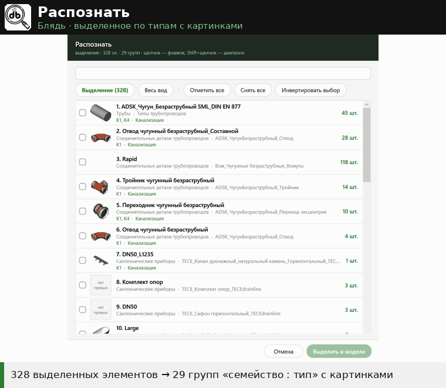

# Распознать

↩ [ХУЙ](../../README.md)

> [!NOTE]
> **Что делает**
> Показывает, из чего состоит выделение или весь активный вид: окно со списком групп «Категория — Семейство — Тип — Количество» с мини-картинкой типа. Отмечаете нужные группы флажками — «Выделить в модели» выделяет их элементы. Модель не меняется.
> С 13.10.2026 умеет всё то же, что Фильтровать, плюс картинки и режим «Весь вид».

## Демонстрация

Выделенное (или весь вид) раскладывается по группам «категория · семейство : тип» с картинками и счётчиком; поиск по имени и системе, флажки (Shift — диапазон) → «Выделить в модели».

## Когда применять
- Выделили рамкой кусок модели и хотите понять, что в него попало, и оставить в выделении только нужные типы.
- Хотите узнать, что вообще видно на текущем виде, и выделить группу оттуда.

## Как пользоваться
1. Выделите элементы — или ничего не выделяйте: тогда распознаётся всё видимое на активном виде.
2. Нажмите «Распознать».
3. В окне строки: флажок · картинка · «№. Тип» и под ним «Категория · Семейство» · «N шт.». Щелчок в любом месте строки ставит/снимает флажок, отмеченная строка — светло-зелёная. **Shift+щелчок** — отметить (или снять) все строки от предыдущего щелчка до этой.
4. Поле сверху — поиск: печатайте любые слова из категории, семейства или типа (все слова должны найтись).
5. «Отметить все» / «Снять все» / «Инвертировать выбор» (отмеченные снимаются, неотмеченные отмечаются) — для всех строк, а если в поиске что-то введено — только для найденных.
6. Если было выделение, есть переключатель **«Выделение (N) / Весь вид»** — список пересобирается без перезапуска.
7. «Выделить в модели (K гр., M шт.)» — заменяет выделение элементами отмеченных групп. «Отмена» / Esc — ничего не меняет.

## Режимы и настройки
- **Выделение** — по умолчанию, если что-то выделено.
- **Весь вид** — только то, что видно на активном виде (модельные элементы и аннотации): скрытые категории, фильтры с выключенной видимостью, скрытые элементы, подрезка и временное скрытие/изоляция учитываются. Элементы связанных файлов не разбираются — связь считается одной группой. Не попадают: камеры, метки разрезов/видов, рамка 3D, базовая точка, точка съёмки.

## Что меняется в модели
Ничего — меняется только выделение.

## Изменения v2.2 (21.10.2026)
- Поиск — ещё и по **«Классификации систем»** и **«Сокращению для системы»**: они показаны третьей зелёной строкой у каждого типа.
- Окно растягивается — список растёт вместе с ним.

## Ограничения и подводные камни
- Окно строится чуть дольше, чем у «Фильтровать»: картинки берутся из Revit для каждого типа (кэш на один запуск). Проверено: 886 элементов / 158 групп на 3D-виде рабочей модели — около 3 секунд.
- У элементов без типа и у многих системных типов картинки нет — серая плашка «нет превью».
- Номера строк совпадают с «Фильтровать», если выделение не менялось.

## Отмена
Не требуется. Прежняя версия (таблица в окне вывода pyRevit) — `script.py.bak_1310`.

## Техническое (для Claude)
- `script.py` v2 (13.10.2026): группировка по (категория, FamilyName, имя типа) — как в Filtr; источник — `Selection` или `FilteredElementCollector(doc, ActiveView.Id)` (CategoryType Model/Annotation, исключения — `SKIP_CATS`).
- Окно — `hui_forms._Dialog` (шапка, подвал), строки — `Border` + `Grid` (CheckBox с `IsHitTestVisible=False`, `Image`, два `TextBlock`, количество), щелчок по `Border` переключает флажок.
- Превью — `ElementType.GetPreviewImage(Size(48,48))` → PNG в `MemoryStream` → `BitmapImage` (`OnLoad`, `Freeze`), кэш по Id типа.
- Временное скрытие/изоляция: `IsElementVisibleInTemporaryViewMode(TemporaryHideIsolate)` (коллектор по виду её не учитывает).
- Shift: `Keyboard.Modifiers`, индекс последнего щелчка `last[0]`, диапазон — только видимые после поиска строки.
- Высота списка фиксирована: `min(560, экран−260, групп×57)`.
- Выделение — `uidoc.Selection.SetElementIds`.
