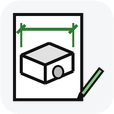
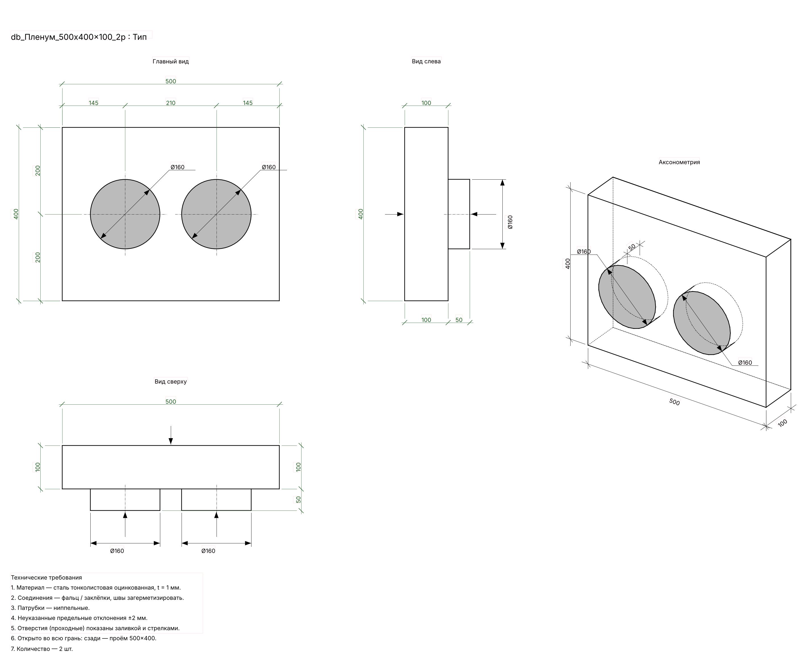
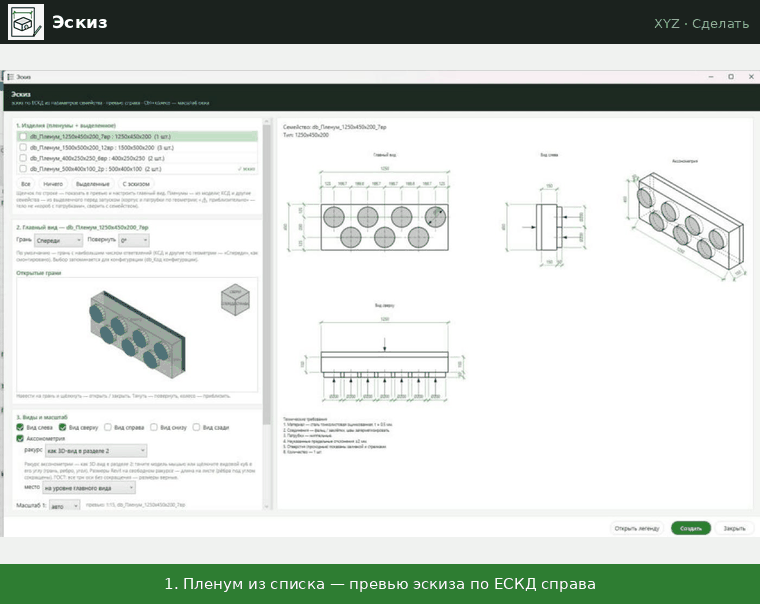

# Эскиз
↩ [XYZ](../../README.md) · Хронология изменений · Разработка · [Пленум](Пленум.md)

## Что делает
Рисует в легенде эскиз нестандартного изделия по ЕСКД — чтобы жестянщик изготовил его без вопросов:
- главный вид, вид слева, вид сверху (и по желанию справа, снизу, сзади) в проекционной связи;
- аксонометрию с выбранным ракурсом;
- размеры: габариты, привязки осей врезок цепочкой, длины патрубков, диаметры и сечения;
- отверстия: «в лоб» — серой заливкой, «с ребра» — стрелкой по оси отверстия;
- технические требования: материал и толщина, соединения, допуски, количество.

Эскиз строится **из параметров семейства**, а не из его видов: ориентацию видов выбираете вы, ракурс аксонометрии — любой, сквозные отверстия видны.

> [!NOTE]
> **Картинка выше** — раскладка, проверенная вне Revit. В Revit те же линии, размеры и тексты; вид шрифта и размерных стрелок — по типам проекта.

## Демонстрация

Изделие из списка → эскиз по ЕСКД; вид выбирается видовым кубом; «Создать» — легенда с размерами Revit.

## Когда применять
- Пленумы, созданные кнопкой [Пленум](Пленум.md), — нужен эскиз для изготовления.
- Сводная легенда всех нестандартных изделий проекта — чтобы видеть весь список.

## Как пользоваться
1. Пленумы окно найдёт само. **КСД и любые другие семейства — выделите в модели** перед запуском: они попадут в список только из выделенного.
2. Нажмите «Эскиз». В окне слева — настройки, справа — превью выбранного изделия.
3. **1. Изделия** — отметьте нужные позиции (пленумы — по типоразмерам, КСД — по длине и патрубкам) («Все», «Ничего», «Выделенные»). Щелчок по строке показывает изделие в превью.
4. **2. Главный вид** — грань (Спереди / Сзади / Слева / Справа / Сверху / Снизу) и поворот (0° / 90° / 180° / 270°). По умолчанию — грань с наибольшим числом ответвлений. Выбор запоминается для этой конфигурации изделия.
5. **3. Виды и масштаб** — галочки дополнительных видов, аксонометрия (азимут и наклон: наберите число и Enter, ↑/↓ — по 5°), её место (посередине группы видов или на уровне главного вида), масштаб (авто или 1:N).
6. **4. Куда** — «Легенда на каждый типоразмер» (имя: префикс + имя семейства) или «Одна легенда со всеми отмеченными» (своё имя).
7. «Создать» — окно «Эскиз — проба» покажет список легенд и масштабы; «Да» — рисует. Окно остаётся открытым: можно поправить и создать ещё. «Открыть легенду» — закрыть окно и перейти к последней созданной легенде.

## Режимы и настройки
- Окно тянется, разделитель между настройками и превью двигается мышью, Ctrl+колесо — масштаб настроек, Ctrl+0 — 100 %. Размер окна, разделитель, масштаб, виды, ракурс и главный вид каждой конфигурации запоминаются.
- Автомасштаб: самый крупный из стандартных, при котором изделие на листе не больше ~120 мм. Для сводной легенды — один масштаб на всех (по самому крупному изделию).

## Что меняется в модели
- Создаётся или **перерисовывается** легенда с выбранным именем: всё её содержимое удаляется и рисуется заново.
- Новая легенда — копия любой легенды проекта без содержимого (Revit не умеет создавать легенду с нуля). В проекте должна быть хотя бы одна легенда.
- Если нет типа заливки «db_Эскиз_Стрелка» — создаётся (чёрная сплошная).
- Используются стили: линии «ADSK_Основная толстая», «ADSK_Основная тонкая», «<Осевая линия>», «db_Скрытые линии»; размеры «ADSK_Основной_2.5 мм» (без округления); текст «ADSK_Основной текст_2.5» / «_3.5»; заливка «ADSK_У_Сплошная_Серый арматура». Если их нет — берутся стандартные стили Revit.

## Ограничения и подводные камни
- Пленумы — по параметрам врезок `db_В1_Грань` … и габаритам `ADSK_Размер_Ширина / Высота / Длина` (кнопка «Пленум»).
- КСД и **любые другие семейства** (из выделенного) — по геометрии экземпляра: корпус — самое крупное тело, патрубки — тела у его граней (прямоугольные, круглые, овальные), Ø — из соединителя, щель снизу — по параметру `2_w`. Решётка в эскиз не входит (по каталогу). Длина и патрубки у КСД свои у каждого экземпляра, поэтому в списке позиция — это экземпляры с одинаковой геометрией («L=…, N шт.»).
- Эскиз по геометрии честен для «короба с патрубками». Если тело другое (круглый корпус, конус, отвод, скосы, детали в стороне) — позиция помечена «⚠ приблизительно», и то же написано в технических требованиях: такой эскиз — габаритный, сверить с семейством перед выдачей.
- Эскиз не «живой»: размеры аксонометрии — линии и текст (размеры Revit на аксонометрии меряют не то). Изменили семейство — нажмите «Эскиз» ещё раз, легенда перерисуется.
- Один и тот же размер может стоять на двух видах — так решено (db, 28.10.2026).
- Сводная легенда кладёт эскизы друг под другом.

## Отмена
Ctrl+Z — отменяет всё созданное одним действием «XYZ: эскиз».

## Техническое (для Claude)
- `lib/xyz_eskiz.py`: слой без Revit — `part_from` (параметры → короб и врезки в координатах «Пленума»: `face_frame`), `build_sketch` / `build_many` → примитивы (line / circle / fill / dim / text), `render` + `bbox` (превью и раскладка); слой Revit — `candidates`, `part_of_symbol`, `styles`, `legend_for`, `emit`.
- Виды: `main_basis(грань, поворот)` → (вправо, вверх, к зрителю); `view_basis` даёт остальные по ЕСКД (первый угол). Размеры видов — `NewDimension` по ссылкам на линии детализации; диаметры — линии + заливки-стрелки.
- Аксонометрия: невидимые куски рёбер — проверка лучом к зрителю против короба и патрубков (`_Box`, `_Cyl`); размеры — линиями по ГОСТ 2.317, место — вне выпуклой оболочки изделия (`_hull`).
- Проверка раскладки вне Revit: matplotlib-рендер `render()` (скрипт в облачной среде сессии 28.10).

> [!TIP]
> Демонстрация и обсуждение — в Telegram-канале [@xyz_for_revit](https://t.me/xyz_for_revit).
